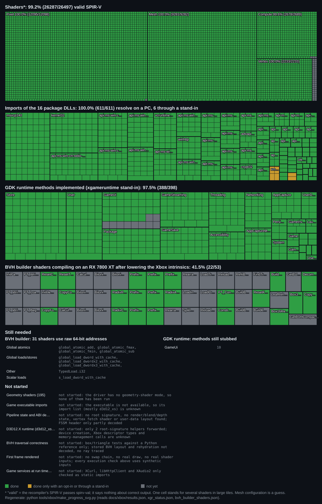

# americas-recomp

Can an Xbox Series game run on a PC through [AnyPS5](https://github.com/boykopovar/AnyPS5)? The Series X GPU shares the PS5's RDNA2 instruction set, so the first question is whether AnyPS5's shader recompiler can translate the game's shaders. This fork (branch `xbox-series`) answers that with the author's own console dump, and also builds the platform pieces the game needs around the shaders. No game files are included.

## Progress

Regenerate with `python tools/xbox/make_progress_svg.py`. It reads `docs/xbox/results.json`, `xgr_status.json` and `bvh_builder_shaders.json`.

"Valid" means the recompiler produced SPIR-V that passes `spirv-val` (Vulkan SDK 1.4.363.1, `--target-env vulkan1.3`). It does not mean the output is correct.

| Stage | Shaders | Valid SPIR-V | Notes |
|---|---|---|---|
| Compute | 2,689 | **2,678 (99.6%)** | best of four fake-memory variants (default, unbacked, tiled T#, tiled V#); 0 invalid; 7 time out, 4 throw |
| Pixel | 12,098 | **12,095 (99.97%, strict)** | no barycentric extension and no f16 opt-in needed any more (#104, #101, and the descriptor-chain work in #86, #87, #91, #94, #102); 3 throw |
| Vertex | 2,233 | 1,445 (64.7%) | the rest need the real vertex fetch shader |
| Mesh | 9,282 | 9,240 (99.5%) | mesh configuration is a guess |
| Geometry | 195 | 195 (100%) | `spirv-val` only for the corpus; `gs_test.py` executes two synthetic geometry shaders |

The corpus is the 26,503 shaders of `shaders.rpf` (26,497 went through the recompiler; 6 do not inflate). The strict pixel number is the headline: the f16 approximation is opt-in and off by default.

## What is verified

- **Execution against a CPU reference.** 242 compute and 157 of 738 pixel shaders were run on a GPU and compared bit for bit with an independent CPU interpreter. The pixel run found no differences. The compute run found one recompiler bug (fixed) and one few-ulp difference explained by a 1-ulp hardware reciprocal. The pixel check uses one constant input, so it says little about interpolation. See [`docs/xbox/XBOX_SHADERS.md`](docs/xbox/XBOX_SHADERS.md).
- **Package DLLs.** All 611 functions imported by the 16 DLLs shipped with the game resolve on a PC; 6 of them (`xmem.dll`, `d3d12_xs.dll`) need the stand-ins in `tools/xbox/platform/`. The game's Bink decoder decodes a real video through the `xmem.dll` stand-in. Static imports only, so this is not a completion figure ([`PLATFORM_SURFACE.md`](docs/xbox/PLATFORM_SURFACE.md)).
- **BVH builder shaders.** The 53 ray-tracing builder shaders use `@xbox.*` intrinsics that crash the AMD PC compiler. 22 of them lower to standard DXIL, sign, compile and dispatch on an RX 7800 XT. The lowered min/max/med3, packed f16 and wave operations match a software model, and the output of the pure-ALU ones is identical on the GPU and on WARP. The other 31 read 64-bit GPU addresses from buffers and need the real addresses from a running game.

## What is built

| Part | Where | State |
|---|---|---|
| Recompiler changes (waterfall descriptor loops, faster structurizer, Xbox ISA, shader header decoder) | `core/shader`, `tools/xbox` | in use for all numbers above |
| Xbox DXIL to PC DXIL lowering | `tools/xbox/platform/xbox_dxil_lower.py`, `lower_all.py` | 22 of 53 builder shaders |
| `xmem.dll`, `d3d12_xs.dll` stand-ins, `D3D12XboxCreateDevice` | `tools/xbox/platform` | load and run; the device layer covers only the calls seen so far |
| Object proxy with per-slot logging (`XS_TRACE=1`) | `xbox_device_proxy.h` | works; shows what a title calls |
| `xgameruntime.dll` stand-in | `tools/xbox/platform/xgr` | 388 of 398 methods implemented (threading, async, offline user, system and startup answers, persistent local storage, installed package, local save games, offline store with the game licensed, launching, game UI drawn by the title, handle tracking); the rest log and fail |

How to use all of it once the game executable is available: [`tools/xbox/platform/README.md`](tools/xbox/platform/README.md).

## What does not work yet

- **Pixel (strict):** most failures read a 16-bit interpolant, refused unless the f16 approximation is on (Xbox sets round-toward-zero and there is no measured model). With every opt-in, 105 still fail: descriptor and sampler chains, 15 over the barycentric location limit, 14 sampling with clamps the emitter rejects.
- **Vertex (862):** 562 computed `s_swappc` targets and 223 fetch-shader calls with no parsed plan. Vertex layout comes from pipeline state, so these wait for the executable.
- **Mesh (378):** 239 sampler and image descriptor chains, 100 runtime-indexed descriptor tables, 28 timeouts, 11 others.
- **Compute (88):** mostly descriptor chains reached through a runtime index or an address-loaded pointer.
- **Everything the executable decides:** formats, blend and depth state, export mapping, descriptor contents. The harness uses defaults. No frame has been rendered.
- **Ray tracing:** 62 of 64 shaders that use the hardware BVH instruction recompile, but nothing was traversed. The 8.3 GB BVH dump's bit layout is not decoded ([`BVH_CONTAINER.md`](docs/xbox/BVH_CONTAINER.md)).

### Assumptions (not verified on hardware)
1. A lane-active select arm in waterfall loops is assumed active (`XBOX_NO_LANE_ASSUME` turns it off).
2. Descriptor heap entries are assumed to be size-aligned (`XBOX_NO_OPAQUE_HEAP_INDEX` turns it off).
3. Opt-in only: 16-bit interpolation ignores fp16 rounding bits (`XBOX_ALLOW_UNMEASURED_F16_INTERP`).
4. `v_mad_legacy_f32` and `v_mac_legacy_f32` are fused, as measured on desktop RDNA2 (gfx1031), not on a Series X (`XBOX_NO_FUSED_LEGACY_MAD` turns it off).

## Where to look
- [`docs/xbox/XBOX_SHADERS.md`](docs/xbox/XBOX_SHADERS.md): full write-up, harness defaults, history of the failure classes.
- [`docs/xbox/PLATFORM_SURFACE.md`](docs/xbox/PLATFORM_SURFACE.md): platform findings, lowering and dispatch results.
- [`tools/xbox`](tools/xbox): driver, runners, binding analysis, header decoder, platform tooling.

## Contributing to the Xbox work

Read [`CONTRIBUTING.md`](CONTRIBUTING.md) and claim an item before starting. The coordination issue [#42](https://github.com/realdody/americas-recomp/issues/42) has the claim commands and current work; the recompiler failure classes are in [#59](https://github.com/realdody/americas-recomp/issues/59) and the `xgameruntime.dll` stand-in interfaces in [#58](https://github.com/realdody/americas-recomp/issues/58). GPU and driver results go in [#47](https://github.com/realdody/americas-recomp/issues/47).

Not included in this repo: shader dumps and any game files.

## Mention: AnyPS5

This is a fork of [AnyPS5](https://github.com/boykopovar/AnyPS5) (GPL-2.0). The original README is below.

AnyPS5 README (original, unmodified)

**English** | [Português (Brasil)](docs/user/README.pt-BR.md) | [Español](docs/user/README.es.md) | [Català](docs/user/README.ca.md) | [Italiano](docs/user/README.it.md) | [简体中文](docs/user/README.zh-CN.md) | [Русский](docs/user/README.ru.md) | [Bahasa Indonesia](docs/user/README.id.md) | [Polski](docs/user/README.pl.md) | [日本語](docs/user/README.ja.md) | [العربية](docs/user/README.ar.md)

# About

Tool for automatic executables porting to Linux and Windows.

The relinker-only build runs on macOS, including Apple silicon.

[**Web converter**](https://boykopovar.github.io/AnyPS5/) - files stay on your device.

Includes a [relinker](core/relinker) that converts executable to the target system's native format and implementations of [system prx libraries](core/libs/prx) suitable for dynamic linking. No emulation or separate runtime process.

[**Discord**](https://discord.gg/x9naWVzC6A), [Usage](docs/user/USAGE.md), [Build instructions](docs/dev/BUILD.md), [Architecture](docs/dev/ARCHITECTURE.md), [Technical debt of the project](docs/dev/TechnicalDebt.md), [code style conventions](docs/dev/CONVENTIONS.md), [contributing](CONTRIBUTING.md)

## Status

   

[Progress history](https://boykopovar.github.io/AnyPS5/history.html)

* System libraries: percentage of the functions known to the project so far (declared in [core/libs/prx](core/libs/prx)), not of every PS5 system function. The total grows as more functions are declared.

Unsupported or unexpected states throw a C++ exception, usually `std::runtime_error`. An exception that nothing catches prints its `what()` to stderr and ends the process.

The [shader recompiler](core/shader/recompiler/Recompiler.cpp) successfully produces SPIR-V (validated via [Spirv-Tools](3rdparty/SPIRV-Tools) when built with `ANYPS5_ENABLE_SPIRV_TOOLS`).

## Compatibility

Per-game status and test reports live in the [Game bring-up](https://github.com/boykopovar/AnyPS5/discussions/categories/game-bring-up) discussions, one thread per title.

## Input mapping

SDL-mapped game controllers are supported, including analog sticks and triggers. Keyboard and mouse controls can be configured with an `anyps5-input.ini` file. See [input mapping](docs/user/INPUT_MAPPING.md) for the supported devices and configuration format.

## Disclaimer

This project is intended for interoperability, research, preservation, and compatibility purposes. It does not include, distribute, or require copyrighted software, firmware, cryptographic keys, or proprietary libraries. Users are responsible for ensuring that any binaries used with this project are obtained and used in accordance with applicable laws and their respective license terms.

AnyPS5 is an independent project and is not affiliated with, authorized or endorsed by Sony Interactive Entertainment. "PlayStation" and "PS5" are trademarks of Sony Interactive Entertainment Inc.

## License

This project is licensed under the GNU General Public License version 2 only.

